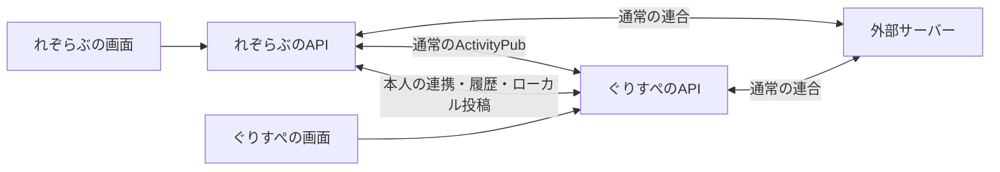

# 04 連携プロトコル

状態: 実装設計案。以下のデータ名・操作名は提案であり、既存 API の仕様ではない。API の具体的なパスと型は、採用基盤を決めてから固定する。

## 構成

両サイトのデータベース、アカウント、認証情報は独立して持つ。同じフォークをサイト別設定で動かし、連携先を許可した二つのホストに固定する。片方の停止中にも、もう片方の通常利用を継続できる構成にする。

通常の公開投稿、Follow、返信、リアクションの配送には既存の ActivityPub を使う。追加する通信は本人の対応関係、共通ローカル投稿、履歴取得、本人としての代理操作など、標準機能だけでは足りない範囲に限定する。

## 共通ローカルの境界

通常の `localOnly` に加えて、共有対象のコミュニティと配送禁止範囲を識別できるメタデータを持つ案とする。相手から受け取ったノートを通常の公開リモートノートとして再配信してはいけない。

| 種類 | 対象範囲 | 外部への扱い |
| --- | --- | --- |
| 通常の連合可能な投稿 | 元の公開範囲に従う | 標準の連合処理 |
| 共通ローカル投稿 | 登録した二つのサイト内 | 通常の配送キュー・リレーから除外 |
| フォロワー限定・指名投稿 | 元の宛先と現在の閲覧権限 | 本人向け取得のみ。全体同期はしない |

更新前のローカル投稿にも履歴取得時に共有ルールを適用する。元データを一括で書き換えることは必須にしない。共通ローカルに由来する返信や引用にも配送制約を引き継ぐ。

この境界はサーバー間の配送仕様であり、公開ページへ誰がアクセスできるかとは別である。未ログイン閲覧の扱いは Q-11 とする。

## データの所在

| データ案 | 原本の所在と用途 |
| --- | --- |
| MemberLink | 旧新 Actor URI の組、リンク ID、状態、世代、確認日時を両サイトで保持 |
| DelegatedGrant | 許可を発行した側が認可を管理。利用側は暗号化したトークンとスコープを保持 |
| FollowImportJob | 新側が初回スナップショット、進捗、結果、取消対象を保持 |
| OriginNoteRef | 投稿元が本文・削除・宛先を管理。受信側は元 URI と参照を持つ |
| PeerCursor | 取得元別に最後に確定したイベント位置を保持 |
| LocalSubscription | サイトごとの Follow 状態。連携後は相互に上書きしない |

短いユーザー ID、ノート ID、通知 ID は単独で二つのサイトをまたいで比較しない。Actor URI、Object URI、またはホストを付けた ID を使う。表示用のメンバー ID を投稿者の Actor URI として送らない。

## 操作の一覧案

| 操作案 | 入力・結果の要点 |
| --- | --- |
| capabilities | プロトコル版、対応操作、共有ルールの有効日時を交換 |
| link.prepare / commit / revoke | 両アカウントの確認、世代の更新、取消。再送で二重登録しない |
| history.query | 元の公開範囲、検索条件、閲覧者の権限を確認して履歴を返す |
| home.query | 取得できる投稿を返す。表示先は自サイトの現在の購読条件でさらに絞る |
| notifications.query / read | 本人の通知だけを取得・既読化する |
| action.submit / status | 操作名義、元ノート URI、操作 ID を確認して実行・結果照会する |
| events.read / acknowledge | 再開可能なイベント取得と受信位置の確定 |

相手サーバーの任意 API を呼べる汎用プロキシにはしない。各操作でホスト、本人の連携、許可、対象を確認する。旧名義での投稿は旧側で作成し、旧側が署名して配送する。新側が旧側の秘密鍵を複製しない。

## イベントと再送

イベントには版、送信元、イベント ID、対象 URI、対象の世代、発生日時、操作種別を含める。種類はリンク状態変更、共通ローカル投稿、削除、対応している場合の編集などとする。連携後の Follow・解除を相手へ反映するイベントは設けない。

受信は重複するものとして実装する。同じイベント ID は一回だけ適用し、同じ Object URI の通常連合と独自配送も重複排除する。順序が逆転しても、削除済みのノートを古い Create で復活させない。

受信処理を永続化してから位置を確定する。停止後は確定した位置から再開する。履歴の補完に新着フラグを付けず、通知を大量生成しない。保存範囲からイベントが消えていた場合は、履歴と削除情報を照合して補完する。

初回の起動時に共有開始日時と両側のイベント位置を記録し、新着の購読と履歴の取得を並行できるようにする。開始時刻の前後に発生した投稿を落とさないよう、重なる範囲を取得して URI で重複を除く。

## 権限と障害

通信相手の認証と、データを読む本人の認可は別に行う。相手が許可済みサーバーでも、全利用者の限定投稿を要求できる権限は与えない。ブラウザから渡された Actor URI や閲覧者 ID を、そのまま本人の証明として使わない。

読み取りタイムアウト時は新側の結果を残し、旧側未取得と表示する。書き込みタイムアウトは成功・失敗を断定せず、同じ操作 ID で結果を確認する。旧名義で失敗した処理を新名義で再実行しない。

権限取消、ブロック、ノート削除で、本文だけでなく検索抜粋、通知プレビュー、添付参照も再評価する。限定データは連携解除・世代変更でキャッシュを無効化し、相手へ再確認できない状態で古い許可だけを使い続けない。

タイムアウト、再試行回数、履歴保存期間、キャッシュ期限、取得上限、許容遅延の数値は Q-10。負荷計測前の数値を運用上の保証として固定しない。
