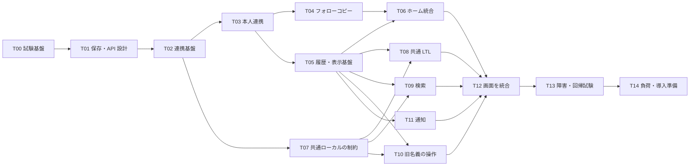

# 09 実装計画

作成日: 2026-11-12。状態: 実装中の計画。基準は `resonite-master` の `b28be53907a8eeebe90efc9741bd637278e15e1a`（`2026.10.0-resonite-love.6`）で、両フォークの `codex/gridspace-bridge` で作業する。試験環境、サーバー間認証、登録後の OAuth 連携、Actor ごとの初回コピーと通常連合でのホーム受信まで実装した。各タスクの残る作業と検証結果は [10-実装状況](10-実装状況.md) を参照する。以下のファイル名・API 名・保存形式には、未実装の案を含む。

最初の動作確認ではぐりすぺでれぞらぶを連携し、フォローを一度だけ引き継いで、れぞらぶの人のホーム投稿を読めるところまで作る。その後、共通 LTL と過去検索、旧名義の返信、通知の統合を揃える。各機能は同じフォークに実装し、両サイトで有効にする。途中の動作確認は試験環境で行い、一般公開の完了条件は全要求の達成とする。

要求は [01-要求仕様](01-要求仕様.md)、期待する振る舞いは [06-受け入れ条件](06-受け入れ条件.md)、本番への導入は [05-導入計画](05-導入計画.md) を参照する。この文書ではそれらを実装する作業と依存関係を定める。

## 1. 到達点と作業順

| 段階 | 試験環境で確認できること | 対応タスク |
| --- | --- | --- |
| M0 基盤 | 二つの連携サーバーと外部サーバーで試験でき、保存形式・API・認可の境界が決まる | T00〜T02 |
| M1 連携してホームを読む | 登録・連携・フォローの初回コピー・解除ができ、G の購読条件で R の投稿を読める | T03〜T06 |
| M2 共通コミュニティを読む | 両サイトの公開投稿と共通ローカルが LTL に流れ、過去履歴と検索が使える | T07〜T09 |
| M3 会話と通知をまとめる | 旧名義で返信でき、通知・既読・失敗時の表示を含めて普段の画面から使える | T10〜T12 |
| M4 公開準備を完了する | 障害復旧、既存機能、負荷、更新と切り戻しを確認する | T13〜T14 |

T07 はホーム統合と独立して進められるが、外部配送を止める試験が通るまで共通ローカルを画面に出さない。認可取消・削除・ブロックの試験は各タスクに含める。T13 まで後回しにしない。

## 2. 実装の基本方針

### 投稿の原本と表示用データ

投稿者の Actor URI、投稿の元 URI、元の日時を保つ。R はれぞらぶ、G はぐりすぺ、E は通常の外部サーバーを表す。G から R を読む場合も、R の投稿者を G のローカルユーザーに書き換えない。

保存方式は次の案で小さく試作し、T01 で確定する。全履歴の事前コピーは利用開始の条件にしない。

| 投稿の種類 | 保存・取得の案 | 必須の制約 |
| --- | --- | --- |
| 通常の連合可能な公開・ホーム投稿 | 既存の `MiNote` と ActivityPub の取得処理を利用。未取得の履歴は投稿元へ問い合わせる | 元 URI で重複排除する。ホーム投稿を全体 LTL に載せない |
| パブリック＋共通ローカル | `MiNote` に二つのサイトだけで共有することを表す永続属性を追加し、`localOnly` と併せて保存する案 | 通常の取得・API・描画・配送でも属性が失われない。返信・引用・Renote に引き継ぐ |
| フォロワー限定・指名、本人の旧権限で取得する投稿 | 投稿元で閲覧者を認可し、本人向けの表示データとして返す | 全員向けの `MiNote` キャッシュや検索索引へ取り込まない。キャッシュは本人・許可・連携世代ごとに分ける |
| ホーム＋共通ローカル、チャンネル等の制限がある投稿 | 元の範囲に応じて購読者向け取得を行う | 共通ローカルという理由だけで全体 LTL や検索範囲を広げない |

画面にはノート本体と、`originHost`、`originNoteId`、`canonicalUri`、`actorUri`、配送範囲、実行可能な操作をまとめた表示用の型を渡す。取得先・名義を表す操作用の参照も付けるが、ブラウザから返された値だけを認可の根拠にはしない。

通常のノート ID だけを受け取る既存 UI に、相手サーバーの ID をそのまま渡さない。参照先の解決、権限確認、操作の送信を共通部品にまとめ、現在の `$i` やログイントークンを一時的に差し替える実装を避ける。

### フォローと閲覧権限

G の購読対象と、R の本人として読める範囲を別々に判定する。他の人の投稿は G の購読対象に含まれ、かつ G の権限または本人の R の権限で読めるものをホームに出す。自分の旧新の投稿とチャンネルの投稿は別に扱い、既存の本人投稿・チャンネル購読の条件を保つ。R のホーム API の結果をそのまま G に足さない。コピー後に G だけで追加した相手も取得対象にできるよう、投稿者とカーソルを指定する取得方法を用意する。

取り込み開始時の Follow 一覧と、その時点で確認できた旧新 Actor の組を固定する。取り込み完了後の Follow は両サイトで独立する。鍵アカウントの新側承認を偽造せず、「購読中」「承認待ち」「旧権限で閲覧中」を分けて保持する。後から相手が連携した場合の追加購読は Q-09 の判断を反映する。

### 連携・認可・通信

サーバー同士の認証と、本人として読んだり書いたりする許可を分ける。許可済みの相手サーバーでも、任意の利用者を名乗って限定投稿を取得できないようにする。

本人の対応関係は双方向で参照できる。一方の OAuth トークンから、逆方向の読み取り許可が自動的に生まれるとは扱わない。両方の画面で個人向け情報を統合するため、それぞれの発行元で本人が認めた許可を保持する。G 側の許可は G の認証済みセッションに結びつけて確認し、R 側の OAuth と同じ連携フローで両方向の利用範囲を示す。書き込みは読み取りと別に許可を求める。

機能の有効化は本人連携、個人向け閲覧、共通 LTL、代理操作ごとに分ける。ただし保存済みの投稿に付いた外部配送禁止は、連携機能を無効にしても解除しない。

## 3. 新設するデータと API の案

名称は実装候補。既存の API と誤認しないよう、利用者向け API は `gridspace/`、サーバー間 API は専用の認証を持つ別のエンドポイントにまとめる。実際のパス、フィールド、エラー、スコープは T01 で固定する。

| データ候補 | 主な責務・制約 |
| --- | --- |
| `GridMemberLink` | 両 Actor、状態、世代、確認日時。各 Actor の有効な組は一つ。両側の合意が揃うまで個人向け機能を開始しない |
| `GridDelegatedGrant` | 発行元、本人、利用側、スコープ、失効状態、連携世代。利用側のトークンは暗号化し、鍵を DB と別に管理する |
| `GridSubscription` | 当該サイトの購読対象、対応する Follow・申請、由来、利用者の変更世代。既存 Follow と食い違わない更新経路を一つにする |
| `GridFollowImport` / `GridFollowImportItem` | 固定した対象一覧、対象ごとの結果、取消、再試行。再認可と新しい取り込みを区別する |
| `GridOutbox` / `GridPeerCursor` / 削除記録 | 永続イベント、重複排除、受信の確定位置、削除後の復活防止。個人の限定本文を共通イベントへ入れない |
| `GridActionReceipt` | 実行元 Actor・操作 ID・入力の要約値・処理状態・結果 URI。同じ ID で異なる本文が来たら拒否する |

| API のまとまり | 利用者向けの候補 | サーバー間で行うこと |
| --- | --- | --- |
| 連携 | `gridspace/link/{start,status,revoke}` と OAuth callback | 本人確認、準備・確定・取消、機能とプロトコルの互換性確認 |
| 引き継ぎ | `gridspace/import/{status,retry,cancel}` | 本人の Follow・制限一覧のスナップショット取得 |
| 閲覧 | `gridspace/{home,local,member,history,search}` | 投稿元の認可を伴う読み取りと履歴検索 |
| 通知 | `gridspace/notifications`、`gridspace/notifications/read` | 取得元ごとの通知取得と既読操作 |
| 操作 | `gridspace/actions/{submit,status}` | 名義と許可を確認し、投稿元で実行・結果照会 |
| 新着・復旧 | 現在のサイトの streaming に専用 channel を追加 | イベント取得・確定・再開。欠けた範囲は履歴と削除記録で補完 |

利用者向け API は通常の認証・レート制限に従い、`endpoint-list.ts` に登録する。レスポンスとエラーは型を定義し、API を変えたタスク内で `misskey-js` を再生成する。サーバー間 API は二つの設定済みホストだけを扱い、任意 URL や任意 API を呼び出すプロキシにはしない。

## 4. 実装タスク

### T00 試験環境と基準動作を用意する

依存: なし。成果物: 再現できる開発・試験手順と、変更前の実行結果。

- 実装用の `codex/gridspace-*` ブランチを `resonite-master` から作る。参照元と提出先を区別し、既存の `origin` が GridSpace の公開先だと決めつけない。
- `package.json` の Node 条件と pnpm `11.25.0` を満たし、ロックファイルに従って依存を導入する。既存の `.config/test.yml` を上書きせず、なければ試験用の例から作る。
- OAuth、TL、公開範囲、通知、通常連合の基準動作を記録する。本番の秘密鍵・トークン・利用者データを試験環境へ持ち込まない。
- [既存の連合試験](../packages/backend/test-federation/README.md) は `a.test` と `b.test` の二台構成。`compose.yml`、`setup.sh`、ホスト設定を拡張し、R/G/E の三台で動かせる試験構成を追加する。E は拡張を利用しない通常の連合先とする。

完了条件: 既存二台試験も維持され、三台で通常の Follow・投稿が届く。失敗は変更前からのものと環境不足を区別して記録する。担当する受け入れ条件: AC-43 の基準確認。

### T01 保存方式・認可・操作参照を小さく試す

依存: T00。成果物: データ定義、API 定義、権限表、短い試作の結果。

公開一件、共通ローカル一件、旧側だけで読める限定投稿一件を使い、取得、画面表示、返信先解決、削除までを試す。新設案の保存形式で既存 `MiNote`、外部配送、ノート詳細画面を安全に扱えるかを確認する。特に共通ローカル属性が通常の API とキューを経ても維持されるかを調べる。旧名義の返信では操作 ID と作成済み投稿を永続的に結びつける方法を試し、T10 で使う二重投稿防止の方式を決める。

主な確認先は [Note モデル](../packages/backend/src/models/Note.ts)、[NoteEntityService](../packages/backend/src/core/entities/NoteEntityService.ts)、[QueryService](../packages/backend/src/core/QueryService.ts)、[NoteCreateService](../packages/backend/src/core/NoteCreateService.ts)、[MkNote](../packages/frontend/src/components/MkNote.vue)。通常 API の互換性、外部からの投稿 URL 取得、画像プロキシ・OGP も扱う。Q-07 を設計として確定し、Q-11 が未決なら一般向けの共通ローカル公開は無効のままにする。

完了条件: 表示用の型、投稿の保存属性、権限の確認箇所、サーバー間のエラーとバージョン交渉が文書化される。既存の通常 API による権限回避が見つかった場合は、修正方式を確定するまで T07 の完成扱いをしない。

### T02 サーバー間通信と永続状態を実装する

依存: T01。成果物: 連携機能を無効にしても起動できる共通基盤。

新設候補の `core/gridspace/` に認証・通信・認可の共通処理を置く。[config](../packages/backend/src/config.ts)、`CoreModule.ts`、`ServerModule.ts`、`ServerService.ts`、`RepositoryModule.ts`、`models/_.ts`、`di-symbols.ts`、`ormconfig.js` に必要な登録を加える。例示設定には秘密情報を入れない。データは必要になる段階ごとに新しい migration で追加する。

最初に capabilities、許可ホスト照合、送信先の検証、リプレイ防止、タイムアウト、エラー分類を実装する。外向き通信でリダイレクト先を無条件に信用しない。世代番号と取消を共通処理にし、イベント送信は DB の更新と対応づく outbox を経由する。受信は適用結果を保存してからカーソルを確定する。

完了条件: 非互換・偽装相手・重複イベントを拒否または無害に処理できる。片側停止で通常のローカル API が止まらない。migration の `up()` / `down()` と差分検査が通る。担当: AC-40、AC-41、AC-42。

### T03 OAuth と旧新アカウントの連携を実装する

依存: T02。成果物: 新規登録時と登録後の連携、状態表示、再認可、解除。

[OAuth2ProviderService](../packages/backend/src/server/oauth/OAuth2ProviderService.ts) の認可コード・PKCE を利用し、`state`、callback の使い回し、現在の G セッションを照合する。[SignupApiService](../packages/backend/src/server/api/SignupApiService.ts) の招待・登録制限等を維持し、OAuth の成功だけで登録条件を迂回しない。本人情報は取得した許可で確認し、申告されたユーザー名やメールだけで組を作らない。

同時 callback の一意制約、両側の準備と確定、片側失敗の取消・再開を実装する。両方向の読み取り許可と旧名義操作の許可を個別に記録する。設定画面には連携相手と許可範囲を出し、解除時に進行中の取得・操作・取り込みを止める。refresh token の存在を前提にしない。

完了条件: 同名別人、重複連携、古い callback、失効した許可を受け付けない。Move は送らず旧側を使い続けられる。認可取消と連携解除を区別できる。担当: AC-01〜AC-06、AC-40。

### T04 初回のフォローコピーと購読状態を実装する

依存: T03。成果物: 対象を固定した取り込み、対象別の結果、取消・再試行。

旧側で一貫した時点の Follow 一覧を確保する。変化中の一覧をページ順に読むだけでスナップショットを名乗らない。制限・ミュート・ブロックを先に評価し、旧新 Actor の展開結果も取り込み対象として保存する。

[UserFollowingService](../packages/backend/src/core/UserFollowingService.ts) と既存 Follow キューを利用する。[ImportFollowingProcessorService](../packages/backend/src/queue/processors/ImportFollowingProcessorService.ts) の CSV 取り込みは参考にし、固定した対象・取消・結果保存を持つ専用ジョブを追加する。利用者の解除とジョブの実行を対象ごとに直列化し、世代確認から Follow 作成までの競合でも解除を優先できるようにする。

通常の Follow・解除 API から変更した場合も購読状態へ反映する。連携後に相手側で行った Follow は取り込まず、再認可時に再コピーしない。承認待ちでも旧権限で読める状態は、承認済み Follow と別に表示する。メンバー単位のミュート・ブロックは両 Actor に適用し、連携し直しても制限を回避できないようにする。

完了条件: 途中失敗・二重起動・解除と同時実行・取り込み中の旧一覧変更に耐え、対象別の結果が画面で分かる。担当: AC-07、AC-09〜AC-13、AC-45、AC-46。

### T05 投稿元を保つ履歴・プロフィール・表示部品を実装する

依存: T03。成果物: 両アカウントの履歴を同じプロフィールから読める API と画面部品。

`gridspace/member` と `history` の新設案を実装し、[users/notes](../packages/backend/src/server/api/endpoints/users/notes.ts) 等の既存条件を再利用する。限定投稿は取得元で毎回の閲覧権限を確認する。元 URI を使った重複排除と、取得元ごとのカーソル・未表示分を保持するページ送りを共通化する。並び順は元の日時と安定したキーで決め、片側停止で未取得範囲を読み終わった扱いにしない。

[MkNoteDetailed](../packages/frontend/src/components/MkNoteDetailed.vue)、`MkNoteHeader.vue`、`pages/user/index.vue`、`pages/user/index.timeline.vue` と操作用の共通部品を接続する。本文だけでなく CW・添付・カスタム絵文字・返信元・投票・引用元にも元の権限を適用する。共通ローカルの表示は T07 の制約実装後に有効にする。

完了条件: 短い ID の衝突、同文の別投稿、Renote、片側の削除、ページ境界を扱える。旧名義専用の操作は T10 まで実行できない状態で表示する。担当: AC-14、AC-17、AC-25〜AC-28、AC-38、AC-39、AC-44。

### T06 現在の購読状態でホームを統合する

依存: T04、T05。成果物: G で R のホーム投稿を読め、G の解除が反映されるホーム。

[notes/timeline](../packages/backend/src/server/api/endpoints/notes/timeline.ts)、[FanoutTimelineEndpointService](../packages/backend/src/core/FanoutTimelineEndpointService.ts)、[home-timeline channel](../packages/backend/src/server/api/stream/channels/home-timeline.ts) の条件を共通取得処理と揃える。取得元では本人の閲覧権限、表示先では現在の購読・ミュート・ブロック・返信表示条件を適用する。

HTTP と streaming で同じ判定を使い、再接続時はカーソルから補完する。初回の取得中に解除した相手の遅れて届く結果も除く。両サイト内の相手と、コピーした外部 Actor の両方を扱う。逆方向も同じ仕組みを使うが、Follow を逆向きにコピーする機能は追加しない。

完了条件: 旧側だけにいる人のホーム投稿が届き、新側で解除すると消える。旧側だけで新しく Follow した人は増えない。担当: AC-08、AC-11、AC-12、AC-20、AC-25〜AC-28、AC-39、AC-41。

### T07 共通ローカルの保存・閲覧・配送制約を実装する

依存: T02、T01。成果物: 共通ローカルと派生投稿を、二つのサイトの範囲に保つ処理。

T01 で確定した永続属性を原本・受信した表示用コピー・返信・引用・Renote に持たせる。[NoteCreateService](../packages/backend/src/core/NoteCreateService.ts)、[NoteDeleteService](../packages/backend/src/core/NoteDeleteService.ts)、`ApRendererService.ts`、`ApDeliverManagerService.ts`、`RelayService.ts`、`DeliverProcessorService.ts` で外部送信を防ぐ。通常キューに誤って入っても最終配送時に検査する。削除やリアクション等の関連 Activity にも適用する。

[NoteEntityService](../packages/backend/src/core/entities/NoteEntityService.ts)、[NoteStreamingHidingService](../packages/backend/src/server/api/stream/NoteStreamingHidingService.ts)、通常ノート API、検索、通知、添付、OGP で元の公開範囲と Q-11 の閲覧方針を守る。R/G 原産の投稿だけを対象にし、外部由来の投稿を独自ルールで共有可能にしない。チャンネル等の既存制限も維持する。

完了条件: E と外部リレーへの送信を三台試験で否定できる。画面操作に加えて API の直接呼び出し、再送、返信・引用の連鎖を試す。機能を無効にしても保存済みの制約が残る。担当: AC-23〜AC-26、AC-39、AC-44。

### T08 共通 LTL と新着・履歴の補完を実装する

依存: T05、T07。成果物: 個別 Follow や本人連携がなくても両サイトの公開投稿が流れる LTL。

新着イベントは通常の公開投稿では元 URI を通知して既存の ActivityPub 取得を利用し、共通ローカルでは専用経路で取得する。個別 Follow がなくても相手側へ新着を知らせる経路が必要で、通常の ActivityPub の配達待ちだけでは完成としない。ホーム・限定投稿の本文は全体イベントに含めない。

[VmimiRelayTimelineService](../packages/backend/src/core/VmimiRelayTimelineService.ts)、`FanoutTimelineService.ts`、`notes/local-timeline.ts`、`local-timeline.ts` の channel を参考に、共通 LTL の選別・保存・streaming を実装する。既存のリレー TL をそのまま共通ローカルとして流用しない。

両側の準備完了時に共有開始位置を保存する。新着と履歴は取得範囲を重ねて URI で重複を除き、履歴取り込みで新規投稿通知を再発行しない。削除記録を保持し、古い Create が後から届いても復活させない。イベント保存期間を超える停止には履歴と削除状態の再照合を用意する。

完了条件: 未連携者の公開投稿も相手の LTL に届き、更新前のローカル投稿をスクロールできる。二重配信・開始時点の欠落・履歴の新着化がない。担当: AC-18〜AC-24、AC-27、AC-28、AC-38、AC-41、AC-42。

### T09 人物検索と過去投稿検索を統合する

依存: T05、T07。成果物: 旧新どちらの名前でも人物を探せ、旧側にしかない履歴を検索できる画面。

[SearchService](../packages/backend/src/core/SearchService.ts)、[users/search](../packages/backend/src/server/api/endpoints/users/search.ts)、[notes/search](../packages/backend/src/server/api/endpoints/notes/search.ts) に、人物の対応表と投稿元への検索を組み合わせる。人物指定を対象 Actor の集合へ展開し、同名の別人は統合しない。

`pages/search.user.vue` と `pages/search.note.vue` に取得元・部分失敗・追加取得を表示する。Meilisearch の public/home 索引と SQL の権限つき検索を分け、Q-05 に沿って対応範囲を定義する。検索件数や抜粋も認可前に公開しない。カーソルは検索語、閲覧者、連携世代に結びつける。

完了条件: G 未保存の R の過去投稿と過去の共通ローカルを検索でき、削除・ブロック後の抜粋が残らない。担当: AC-15〜AC-17、AC-22、AC-25、AC-26、AC-38、AC-39。

### T10 旧名義の返信と操作の送信先を実装する

依存: T05、T07。成果物: 旧名義だけが参加できる会話への返信と、結果不明時の照会。

`gridspace/actions` の新設案から旧側で [notes/create](../packages/backend/src/server/api/endpoints/notes/create.ts) 相当の処理を行う。実行の直前にも許可・世代・宛先・公開範囲を確認し、署名と配送は旧側が担当する。`MkPostForm.vue`、`utility/get-note-menu.ts`、`composables/use-note-capture.ts` には操作先を渡し、旧名義と公開範囲を送信前に明示する。

操作 ID ごとに同時実行を防ぎ、投稿の保存と結果の記録を原子的に対応づける。単に「先に投稿して、後で結果テーブルへ保存する」だけでは、間のクラッシュで重複する。既存の投稿処理で同じトランザクションにできない箇所は、操作 ID から作成済み投稿を一意に復元できる保存方式を用意し、通知・配送も再実行で重複させない。

添付の新規アップロードは操作する Actor が所有するファイルとして扱い、G のファイル ID を R に直接渡さない。リアクション・投票・削除・通報等も送信先と権限を確認し、対象を扱えない操作を通常の G API へ誤送信しない。編集の提供範囲は採用コードで確認する。

完了条件: 応答喪失と投稿保存直後のクラッシュでも二重投稿しない。旧権限が失効したら再認可を示し、新名義へ切り替えて送らない。外部からは引き続き二つの Actor に見える。担当: AC-24、AC-33〜AC-37、AC-39、AC-40、AC-44。

### T11 通知と既読状態を統合する

依存: T05。成果物: 両受信先の通知一覧、未読表示、取得元への既読反映。

[i/notifications](../packages/backend/src/server/api/endpoints/i/notifications.ts) と `i/notifications-grouped.ts` の取得には `markAsRead: false` を使う。キーは取得元・受信 Actor・通知 ID の組にし、別アカウント宛ての通知を同じ ID だけで消さない。取得元が停止した場合、未取得を未読ゼロとして表示しない。

[NotificationService](../packages/backend/src/core/NotificationService.ts) の現在の既読は Redis の最終既読位置を使うため、通知モデルへ既読フラグを足すだけでは済まない。部分的な既読記録と全件既読の位置を両立させ、通常の通知画面・未読数・streaming と同じ状態を参照する方式を実装する。表示した通知 ID だけを既読にでき、同時に届いた未表示通知が消えないことを確認する。

`MkStreamingNotificationsTimeline.vue` と `pages/notifications.vue` を接続し、再接続時は欠落分を取得する。OS プッシュは Q-08 の決定を受けて別の配送試験を追加する。画面内通知の完成だけでプッシュも完成したとは扱わない。

完了条件: 背景取得は既読を変えず、部分既読・全件既読・グループ表示が両側の状態と矛盾しない。担当: AC-29〜AC-32、AC-39〜AC-41。

### T12 普段使う画面に統合する

依存: T06、T08〜T11。成果物: 登録から閲覧・会話・解除まで一通り使える画面。

[MkSignupDialog.form](../packages/frontend/src/components/MkSignupDialog.form.vue)、`pages/signup-complete.vue`、設定画面、`pages/timeline.vue`、`MkNotesTimeline.vue`、`MkStreamingNotesTimeline.vue`、プロフィール、検索、通知に接続する。共有 LTL は普段の LTL として選べる位置に置き、別の試作用画面だけで完了しない。標準の引っ越し設定とは別の連携項目にする。

本人の連携と相手の投稿元、操作名義、取り込みの承認待ち、取得の遅延、部分失敗、再認可、解除済みを表示する。既存 API を利用するクライアントとの互換性は T01 の方針に従い、独自 API が必要な機能を明記する。全サードパーティークライアントの改修を今回の必須範囲には含めない。

日常操作、モバイル幅、キーボード操作、スクリーンリーダー用ラベルを確認する。日本語は `locales/ja-JP.yml` のみ編集する。コンポーネントの状態は Storybook、主要操作は Playwright で確認する。

完了条件: kokoa が G に連携し、A の投稿を読み、旧会話へ返信し、両側の通知を確認して解除する流れを画面だけで完了できる。R 側でも許可された統合閲覧を確認する。担当: AC-01、AC-08、AC-14〜AC-16、AC-18、AC-29〜AC-35、AC-44。

### T13 障害・解除・既存機能を横断して試験する

依存: T12。成果物: [AC-01〜AC-46](06-受け入れ条件.md) の実行記録と、追加した境界条件の試験。

各タスクの試験に加え、片側停止、途中の DB・キュー停止、順序逆転、期限切れカーソル、リンクの再作成、アカウント停止・削除、ブロック変更を組み合わせる。新着、本文、検索抜粋、引用、通知、添付のどこかに古い許可が残っていないか確認する。失効した権限を再確認できない場合は限定データを表示しない。

T07 の制約を無効化できないこと、E へ意図しない投稿・関連 Activity が届かないこと、旧外部フォロワーへの自動転送がないことを確認する。拡張を無効にした通常運用と、基盤更新後のログイン・投稿・Follow・標準 LTL・連合も試す。

完了条件: 全受け入れ条件に、対象コミット、環境、結果、証拠、未解決事項がある。必須条件の不合格を残して一般公開しない。担当: 全 AC。特に AC-23、AC-24、AC-34、AC-38〜AC-43。

### T14 負荷・配備・復旧手順を完成させる

依存: T13。成果物: 本番用の更新手順、観測項目、停止・復旧手順と試験結果。

Q-01 の本番差分と Q-10 の規模を確認して、初回 Follow、ホーム、共通 LTL、履歴検索、通知、長時間停止からの補完を別々に測る。重い取り込みが通常投稿を圧迫しないよう、並列数・上限・再試行・保存期間を測定結果から決める。数値は測定前に性能保証として置かない。

[05-導入計画](05-導入計画.md) に従い、バックアップからの復元、拡張無効での起動、片側ずつの更新、互換性確認、共有開始位置の確定、運営アカウントでの試験、段階公開をリハーサルする。監視には部分取得・遅延・削除未反映・取り込み失敗も含め、通知先と担当を決める。

完了条件: 旧バージョンに戻せる範囲と DB 復元が必要な範囲が明確で、機能停止後も通常利用と外部配送禁止を維持できる。公開日時と担当を確定する。本番配備の実施はこの計画作成には含めない。

## 5. 未決事項を決める時期

[07-決定ログ](07-決定ログ.md) の Q を残し、以下を実装時の判断順とする。提案を利用者の合意済み事項に変更しない。先に進められるタスクは継続する。

| 判断 | 決める期限 | 推奨案・準備できること |
| --- | --- | --- |
| Q-07 データと API | T01 の終了まで | この計画の型・保存案を試作で確認し、実装上の判断として記録する |
| Q-06 解除後の表示・Follow | T03/T04 の画面仕様確定まで | 旧権限と公開の紐づけは解除し、コピー済み Follow は維持する案。認可だけの取消では紐づけと区別して表示する |
| Q-09 後から連携した相手の購読 | T04/T06 の完成まで | 自動の Follow 追加はせず、購読を追加できる案。初回コピー時に連携済みの組を展開する処理とは分ける |
| Q-11 未ログイン閲覧 | T07 の一般向け有効化まで | 連合配送の禁止と Web 閲覧可否を分けて決める。未決の間は共通ローカルを一般公開しない |
| Q-05 検索範囲・方式 | T09 の API 固定まで | 公開・ホーム・過去の共通ローカルは対象。限定投稿は本人認可つき取得を前提に方式と性能を確かめる |
| Q-08 OS プッシュ | T11 の公開範囲確定まで | 初回は画面内通知を必須とし、プッシュは別の追加範囲にする案 |
| Q-12 追加の引き継ぎ | T12 の登録画面確定まで | Follow と閲覧に必要な制限の適用を優先。プロフィール・リスト・ドライブの全移植は別タスクとする案 |
| Q-13 解除・停止時の表示 | T03 と T12 の完成まで | 再認可、通信障害、解除、退会、運営による停止を分ける。運営の停止・解除手段も実装する |
| Q-01 本番差分、Q-10 性能・運用 | 調査は T00 から、確定は T14 まで | 本番情報がなくても機能開発は進められる。更新日・許容負荷・保存期間・担当の確定は配備の条件にする |

## 6. 検証と変更の分け方

一つのタスクに、実装、必要な migration、API の生成物、最も近い試験、仕様の更新を含める。DB 全体、backend 全体、frontend 全体を別々の巨大な変更にしない。T10 の二重投稿対策や T07 の配送制約は、使う画面を公開する前に成立させる。

タスク着手時には対象の backend / frontend スキル、提出時には [shipping-misskey-change](../.claude/skills/shipping-misskey-change/SKILL.md) を参照する。endpoint と Vue を変更したときは、同スキルが指定するレビューも行う。

以下は今後の実装時に使うコマンド。今回実行した結果を表すものではない。個別試験は追加したテスト名や実在するファイルへ絞って実行する。

| 変更・試験 | 実行する検証 |
| --- | --- |
| backend の条件分岐・変換 | `pnpm --filter backend test --run <対象>` |
| 認可・履歴・Follow・操作の API | `pnpm --filter backend test:e2e --run <対象>` |
| frontend のカーソル・参照・状態処理 | `pnpm --filter frontend test <対象>` |
| frontend の型 | `pnpm --filter frontend typecheck` |
| 主要 UI フロー | `pnpm e2e`。T00 で R/G を使える試験設定を追加し、対象フローを確認する |
| API のスキーマ変更 | `pnpm build-misskey-js-with-types` と生成差分の確認 |
| entity / migration | `pnpm --filter backend check-migrations`、`up()` / `down()` の試験 |
| 複数サーバーの配送・外部視点 | T00 で追加する三台構成から `pnpm --filter backend test:fed` 相当を実行する。既存二台試験も維持する |
| 各変更の提出前 | `node scripts/check-shipping.mjs --base resonite-love/resonite-master`。変更対象の lint、SPDX、locale safety を確認する |

backend の試験前には試験用 DB/Redis と `.config/test.yml` を用意する。API 試験のサーバー起動は既存の試験基盤に任せ、別の `start:test` を重ねて起動しない。連合試験は事前ビルドと Docker 構成が必要で、コマンド単体を実行すれば三台が用意されるわけではない。

最初に着手するのは T00、次に T01 とする。T01 で保存方式と旧名義操作の実現方法を確認した時点で、T02 以降を変更単位に分割し、工数を見積もる。現段階では担当人数・本番規模・試作結果が不明なため、日付だけの完成予定は置かない。
