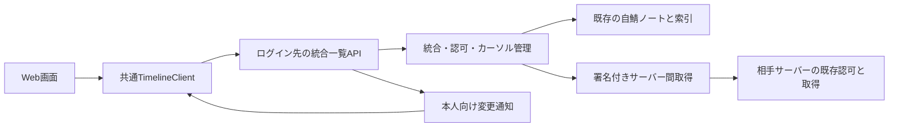

# タイムライン統合のサーバー移行計画

作成日: 2026-11-17。状態: 利用者の承認を受け、両フォークで実装中。レビューの指摘と対応は[66-独立レビュー記録](66-タイムライン統合計画の独立レビュー.md)に残す。

> **実装時の変更（2026-11-17）**: 全履歴の共通時刻索引と正規化台帳は採用しない。実測した件数と試算では、れぞらぶの空き容量に収まらないため。代わりに、同じ投稿を表示する取得元をセッション内で一つに決め、既存の索引で取得した一覧をサーバーで統合する。[67-実装時の設計と検証記録](67-統合一覧の実装時設計と検証.md)を現在の仕様とする。この文書の参照索引・正規化台帳・共通tupleに関する記述は、比較用に残す旧案。変更記録、認可、本文の有効期間、互換性、段階的配備の要件は引き続き適用する。

## 1. 目的と対象

れぞらぶ（R）とぐりすぺ（G）の投稿を一つの一覧にする処理を、ブラウザからログイン先のサーバーへ移す。フロントエンドは統合済みの順序と続きの取得位置を受け取り、表示・スクロール・アニメーションを担当する。

今回の計画で扱う「統合」は次の処理を指す。

- 取得元の選択、閲覧権限・購読条件の適用、重複除去、並べ替え。
- 取得元ごとのページ送りと、未出力の項目の保持。
- 新着の取り込み、削除・権限変更後の再取得、取得失敗と再試行。

既存のアカウントは別のままにする。DBは接続・統合しない。外部の通常MisskeyとのActivityPub動作は変更しない。最初はホームとソーシャルを対象に実装し、同じ仕組みを他の投稿一覧へ広げる。通知は投稿とは順序・既読・グループ化の意味が違うため、独立した後続工程にする。

当初の依頼は計画と独立レビュー。その後「レビューしつつ実装を進めて、デプロイまで」「れぞらぶぐりすぺもいっしょ」と承認されたため、両フォークへの実装・コミット・配備まで進める。

## 2. 現状の調査結果

確認したコミットは R `1143b4727a` / G `2317c67486`（それぞれ `2026.11.0-*.31.37`）。以降の着手前に作業先と本番のバージョンを再確認する。

ブラウザは原則としてログイン先のAPIを呼ぶ。相手サーバーへの本文取得と認可はバックエンドが行う。しかし、取得した複数の一覧を最後に混ぜる処理はブラウザに残っている。

| 領域 | 現在の処理 | 主な確認先 |
| --- | --- | --- |
| 公開・ホーム・連合なし投稿の共有 | サーバー間で受け取り、通常ノートとして保持。LTL・ホームの既存処理へ流す | `packages/backend/src/core/gridspace/GridspaceNoteService.ts`、`NoteCreateService.ts`、`server/api/endpoints/notes/local-timeline.ts` |
| ホーム・ソーシャル | 通常APIと `gridspace/private-notes` を別取得。順序・重複・取得境界をフロントで統合 | `packages/frontend/src/utility/use-gridspace-home.ts`、`components/MkStreamingNotesTimeline.vue` |
| プロフィール・検索 | 公開投稿の両サーバー統合は一部バックエンド済み。限定投稿の一覧は別に取得してフロントで追加 | `GridspaceHistoryService.ts`、`GridspaceSearchService.ts`、`use-gridspace-note-list.ts` |
| メンション・指名・お気に入り | 自鯖APIと連携権限で読む一覧をフロントで統合 | `use-gridspace-note-list.ts` |
| 連携先のチャンネル・アンテナ・クリップ | 専用取得、再認可、再試行などをフロントが管理 | `MkGridspacePrivateNotes.vue`、`use-gridspace-note-list.ts` |
| 通知 | `source=local/peer/channel` の3系列を別取得し、フロントで順序・既読・グループ化を管理 | `use-gridspace-notifications.ts`、`GridspaceNotificationService.ts` |
| アンテナ一覧など | 共通 `misskeyApi` 内で、一部のリソースIDやAPI名を専用APIへ振り分ける | `utility/gridspace-managed-api.ts`、`utility/misskey-api.ts` |

現状の独立した定期取得は、ホームが10秒、連携投稿一覧とチャンネルが15秒、通知の新着確認がおおむね10秒。表示済みの限定投稿を100件ずつ再確認する経路もある。これをそのままバックエンドの利用者全件ポーリングへ移すと負荷が増えるため、その方式は採らない。

上表のバックエンドのファイルは `packages/backend/src/core/gridspace/`、フロントのユーティリティは `packages/frontend/src/utility/`、コンポーネントは `packages/frontend/src/components/` を起点に読む。通常のホーム・ソーシャルは `packages/backend/src/server/api/endpoints/notes/timeline.ts` と `hybrid-timeline.ts`、WebSocketは `server/api/stream/channels/home-timeline.ts` 等を確認する。

## 3. 保つ動作

1. GのホームはGの現在のフォロー条件を使う。Rの旧アカウントのフォロー一覧を、そのまま二つ目のホームとして足さない。旧アカウントは限定投稿を読める権限として使い、Gの購読条件も適用する。
2. Rでのみ読めるフォロワー限定・指名投稿は、連携済みの本人だけが読める。Rでの認可確認とGでのミュート・ブロック等を両方適用する。
3. フォローは継続的に同じ状態へ同期しない。既存の初回コピーと連携アカウントの自動フォロー規則は変更しない。
4. RのチャンネルはGから読める。GのチャンネルをRへ公開する機能を新設しない。Gのみのアカウントにはチャンネル用の権限だけを与え、他人の旧アカウント権限を与えない。
5. 同じObject URIが連合と専用通信の両方で届いた場合は一件にする。別の投稿、別のリノート、同文投稿は混ぜない。
6. 標準の `notes/timeline` などの返却型・IDの意味は変えない。通常の外部クライアント向けAPIに、旧アカウントでしか読めない本文を突然追加しない。
7. 投稿名義、返信・リアクション・投票・削除の権限は従来どおり。表示の統合だけで操作名義を変えない。
8. 限定投稿の本文・添付URLは永続的な共有キャッシュ、通常のノートストア、検索索引、ログへ新たに保存しない。
9. タブを離れた際の限定本文の破棄、復帰時の再認可、スクロール位置・CW・新着待機・アニメーションの動作を保つ。

## 4. 構成案

### バックエンド

- `GridspaceTimelineService` を統合の入口にする。画面ごとに取得順序を組み立てさせない。
- `TimelineSource` は取得元ごとの読み取りを担当する。通常ノート、旧権限ノート、連携チャンネルなどを同じページ操作にそろえる。既存endpointのHTTP呼び出しはせず、サービスを抽出・再利用する。
- `TimelineMergeService` は本文を扱わず、参照・順序キー・重複キーを用いて統合する。返却直前の本文取得と再認可は別工程にする。
- `TimelineReferenceIndex` は自サーバーの既存ノートについて、正規URI・原本の作成時刻・順序キーを索引化する。異なる順序の既存APIをそのまま結合せず、すべての取得元が同じ比較規則でページを返せるようにする。
- `TimelineChangeLog` は投稿日時とは別に、取得・削除・権限変更が確定した順序を記録する。新着・再接続はこの位置を使う。
- `TimelineSessionStore` は取得元別のカーソル、未出力の参照、条件、世代、有効期限を保持する。Redisには限定本文を保存しない。
- `GridspaceTimelineStream` はログイン中の本人の購読だけを管理する。休止中の全利用者を定期走査しない。

これらは提案名。`packages/backend/src/core/gridspace/timeline/` にまとめ、既存の `GridspaceLinkService` へ一覧機能を追加し続けない。サーバー間の取得処理とアプリ向けAPIのDTOは別の型にする。

### フロントエンド

- `TimelineClient` が統合APIと本人向け変更通知を扱う。画面には順序付きの行、読み込み状態、次ページ有無、再試行操作を渡す。
- 画面ごとの `normalCursor/privateCursor`、`normalBoundary/privateBoundary`、統合ソートと定期取得を撤去する。
- ローカルの表示設定、スクロール位置、折り畳み、CW展開、アニメーション、新着を上へ出すタイミングはブラウザが管理する。
- プラグインは取得されたノートの表示用コピーに適用する。表示の加工でサーバー側の順序・カーソル・権限を変更しない。
- 通常ノートと旧権限ノートの型は当面分ける。カードの共通部品は使い、操作は型ごとの既存処理へ渡す。権限の異なる投稿を、IDだけ置き換えた通常ノートへ変換しない。

## 5. 統合APIの契約案

最初に `POST /api/gridspace/timeline` を追加する。初版の対象は `home` と `social`。後続で `profile/search/mentions/direct/channel/antenna/clip/favorites` を追加する。通知は別APIとする。

初回要求は `kind`、そのkindで許可された対象ID・検索条件・フィルター、`limit`（1〜50、既定20）を受ける。通常ページは同じ条件と `cursor` を受ける。`cursor` と任意の別のユーザーIDの組合せを本人の証明として扱わない。

返却の概要は次のとおり。

| フィールド | 意味 |
| --- | --- |
| `version` | 統合API契約のバージョン。初版1 |
| `session` / `revision` | 本人・条件に結び付いた一覧セッションと応答世代 |
| `items` | サーバーで順序と重複を確定した行 |
| `nextCursor` | 統合順序を維持して次へ進む位置。ブラウザで解釈しない |
| `updatesCursor` | 新着差分の確認位置。過去ページの位置とは別に保持 |
| `complete` | 要求した取得元が全部応答し、統合順序を確定できたか |
| `sources` | 各取得元の `ok/unavailable/unauthorized/disabled` と再試行可否。生の例外・トークンは含めない |
| `revalidateAfterMs` | 限定行を再確認するまでの時間。通信失敗時は限定本文を隠す |

各行は `key`、`sortKey`、`ref`、`representation`、`payload` を持つ。`key` は投稿の正規URIを基本とする。`ref` はサーバーが発行する検証可能な参照で、取得元、原本ID、操作名義を特定できる。`representation=normal` のpayloadは既存のPacked Note、`delegated` は既存のPrivateNoteを利用する。短い生IDだけで取得元を推測させない。

認証・scopeは初版を `secure: true` のログインセッション専用とする。任意のアプリトークンへの旧アカウント権限の委譲は、別途明示的に設計する。これにより既存のOAuth scopeから読み取り権限を広げない。返却は `Cache-Control: private, no-store` とし、CDN・共有キャッシュへ保存しない。

既存 `gridspace/private-notes`、`gridspace/history`、`gridspace/search` は移行期間中も残す。標準APIに新しい必須引数や新しい返却型は追加しない。機能の有無は既存の管理・状態APIに能力情報を追加して判定する。

## 6. 順序とページ送り

### 取得元の読み取り契約

`TimelineSource.read` は、有限件数の参照、取得済み範囲、同値時刻を含む次位置、終端かどうかを返す。参照は本文ではなく、原本URI、原本ID、時刻、原本の取得先、候補となる表示型を含む。

通常ノートの履歴には安定した並べ替え順のDB読み取りを用意する。通常HTTP endpointを内部で再呼び出して、返却された件数だけから終端を推測しない。既存のファンアウトは候補抽出に使えるが、フィルター後に空ページが続くときも進める取得境界が必要。

並び順は `(sortAt DESC, canonicalUri DESC COLLATE C)` とする。`sortAt` は原本が返す作成時刻、お気に入りでは保存時刻を使う。現行クリップは投稿作成時刻の順序を保つ。短いIDをRとGで大小比較しない。二つのサーバーの時計が完全に同期しているとは仮定せず、原本時刻を決定的に比較する。

既存のAPIは原則としてローカルのノートID降順であり、同時刻の原本URI降順とは一致しない。そのままアダプターで包むだけでは実装できない。R/Gそれぞれに `TimelineReferenceIndex` の複合索引を追加し、通常取得と旧権限取得の双方が上記tupleのキーセットで範囲を読めるようにする。同時刻の全件をメモリへ読み切ってからソートする方法は使わない。10万件が同時刻でも、20件ずつ進められることを検証する。

索引は既にそのサーバーが保有するノートだけを対象にし、旧権限で読める他サーバーの限定本文・作者を新たに複製しない。R/Gの原本とキャッシュが重なる場合は、原本のtupleを署名付き応答で返し、キャッシュの索引もそれにそろえる。

既存の外部投稿には、元の `published` を復元できないものがある。objectidの秒精度や、将来日時を受信日時へ丸めた履歴から、失われた値を推測で作らない。旧権限での外部投稿があるRの保存日時を優先する正規化台帳をR側に置き、Rに存在しないG側の候補はGの保存日時を初回の値として登録する。登録後の値は、あとから別のキャッシュが見つかっても変更しない。台帳は正規URIのハッシュ、sortAt、値の由来、規則の世代だけを保持する。R/Gで同じ外部URIを表示する場合は同じ値を使う。

台帳への照会・登録は、既にその利用者が読める候補の一括取得中にだけ行う。Gで読めないRの投稿一覧や原URIを台帳同期で渡さない。旧権限側の参照と正規化値は本文と同様に本人向け応答へ限定する。新規受信では検証済みのpublishedを記録し、欠損時はその受信ノードの受信時刻を同じ台帳へ一度だけ登録する。表示用createdAtを書き換える必要はない。履歴の精度差がsortAtに残ることは文書化する。

正規化が必要な候補は順序を確定する前に索引へ反映し、索引の世代を変えたら当該セッションを再作成する。Rの台帳が停止中なら未正規化の外部候補を完全な統合ページへ混ぜず、ローカルfallbackを使う。これにより、正しい順序が不明な行を返して後のページで修正する動作を避ける。P0でこの台帳と既存索引の結合コストを計測し、許容できなければ同じ要件を満たす方式へ計画を見直す。

索引の作成は通常のノート作成・受信と同じトランザクションで行う。正規化待ちも明示的な状態として記録する。既存ノートは本文の走査や1件ごとの外部通信をせず、主キーの範囲ごとに小分けで移す。R/G原本のtupleは既存の一括peer取得、外部投稿は上記の台帳用一括APIで補う。既存のread-manyが第三者の投稿を返せるとは仮定しない。索引の網羅性とR/Gの対応が確認できるまで新一覧を本番既定にしない。索引変更で比較規則が変わる場合は世代を上げ、旧セッションへ混在させない。

### 未出力項目を落とさない

1. 初回は取得元ごとに上端を固定する。後から増えた投稿はこの履歴スナップショットへ混ぜず、新着として扱う。
2. 各取得元から小さいバッチで参照を読む。まだ出力していない候補はセッション内に残す。
3. 各取得元の先頭候補か、tupleで先へ進めたことを示す境界・終端が揃うまで比較する。同時刻のページ境界もtupleの比較で扱い、時刻帯全体の先読みはしない。
4. 全候補中で次に来る参照を選び、現在の権限と購読条件を確認する。拒否・削除された候補は消費して次の候補へ進む。
5. 正規URIが同じ候補をまとめる。ログイン先の権限でも読める通常表現を優先する。通常表現が隠れている場合は、旧権限で読めるdelegated表現を使う。
6. 全取得元の境界が通過するまでは、同じURIが後のページへ重複しないよう消費済みキーを残す。
7. 指定件数か処理上限に到達したら、未出力参照と取得元ごとの位置を一緒に保存して次のカーソルを発行する。スキャンが進んだ空ページは、進行するカーソルと `complete=true` を返せる。

カーソルはRedisの変更不能なチェックポイントを指すランダムIDと署名にする。同じカーソルの並行・再試行で位置を二重消費しない。初回の比較結果をCAS（未確定のときだけ保存する操作）で確定し、選択した参照列と次カーソルを固定する。再試行中に権限を失った行は返却から除くが、その穴に次ページの候補を詰めない。次カーソルは初回と同じにする。これにより、遅い再試行応答が別のページ境界を返さない。

チェックポイントには本文を入れず、参照と取得位置だけを保存する。同じカーソルの再読でも本文の認可は再確認し、取り消された投稿を再返却しない。認可拒否による消費済み行が後で読めるようになった場合は、後述の認可変更イベントでセッションを再作成する。

チェックポイントを本人、一覧kind、条件のハッシュ、R/G双方の認可世代に結び付ける。条件変更、再連携、別ユーザー、改ざんでは拒否する。初期案は無操作30分、セッション開始から最大2時間で失効させる。期限切れ・Redis再起動時は、次ページを空として終わらせず `CURSOR_EXPIRED` を返して先頭または表示位置から再開する。

## 7. 限定投稿の認可と画面復帰

権限判定の責任はサーバーに置く。`representation` は保存先の意味であり、ブラウザが自由に許可を選択するフラグではない。

- 初回・次ページ・差分・再認可の全経路で、相手側の本人確認と現在の閲覧権限を確認する。ローカル側でも現在のフォロー、ミュート、ブロック、チャンネル条件を適用する。
- Gでのフォローを外した場合、Rで旧アカウントがフォローを継続していても、Gのホームの購読条件から外れる。指名投稿、セルフ投稿、フォロー中チャンネル等の例外は現行コードの条件からテストへ写して固定する。
- 本文を組み立てた後にも認可を再確認する。返信・引用・投票・添付にも同じ判定を適用する。
- 限定行は短い有効期間で再確認する。初期値は10秒とし、期限は相手側で最後に認可した時点から数える。APIは残りの有効期間を返す。ネットワーク待ちの間もクライアント側の独立したタイマーで期限切れの本文・作者・Blobを隠す。次の10秒タイマーと最大8秒の取得完了を待ってから隠す方式にはしない。
- 相手とブラウザの時計の差に依存しないよう、サーバーは相手応答から自分の処理時間を引いた残り時間を返す。ブラウザは要求開始時点の単調時計を基準に保守的な失効時刻を置き、ネットワークで遅れた分を延長しない。有効時間を使い切った応答は描画しない。
- ブラウザが非表示になると、現在どおり限定行の本文・作者・添付Blobを破棄する。位置・高さ・キーだけ残す。復帰は一つの再認可要求へまとめ、完了するまで本文は出さない。
- 通常表示から旧権限表示への切り替え、旧権限の取り消し、ノート削除は、同じkeyの置換または除去として返す。退場アニメーション中に本文を残さない。
- 再認可の対象は表示中の行だけでなく、新着待機中・取得途中のバッファに残した行も含む。上へ戻って新着を表示する直前にも有効期間を確認し、期限切れなら本文を出さず再認可する。
- 時間経過だけで公開範囲が変わる行は、通常表現であっても再認可対象とする。相対日数による過去投稿の非公開化・フォロワー限定化、ミュート期限等の次の判定時刻を `nextPolicyCheckAt` として返し、旧権限行と同じ独立タイマーで古い本文を隠す。再確認で通常→旧権限への置換または除去を返す。固定の公開範囲だけを持つ通常行まで、一律10秒ごとに本文を破棄しない。

この計画は瞬時の権限取消を保証しない。変更通知の到達前でも、有効期間が終わるまでに再確認する。API応答とサーバー間通信の後に取消が発生する競合は、短い有効期間と次回の認可で処理する。取得後のブラウザから既に読んだ内容を回収できるという保証もしない。

## 8. 新着と再接続

初版は一つの統合APIで履歴と再確認を完成させる。P2の段階で後述の変更記録と差分取得も含める。10秒ごとのフォールバック確認を共通TimelineClientが一覧セッション単位で行い、旧実装の複数タイマーは同時に動かさない。

投稿日時や `note.id > 前回のID` は新着確認に使わない。現在のノートIDは外部の `published` から作られるため、長い配送遅延や履歴の取り込みで、前回より古いIDの投稿が後から現れる。この場合も表示対象へ含める必要がある。

`TimelineChangeLog` のイベントには連番、正規URI、種別、認可変更の対象、確定時刻だけを保存する。通常作成・AP受信・peer取込・削除・購読条件と認可の変更は、データ変更と同じトランザクションにoutboxを置く。通常トランザクション内で単純に採番すると、連番の小さい遅いトランザクションが後でcommitして欠落するため、outboxの確定済み行を短い直列トランザクションで変更記録へ反映してから採番する。変更記録の連番順はその確定後の順序とする。

時間経過による変更はDB書き込みがない場合もある。相対公開範囲の期限、ミュートの終了、期限付きロールの変更等を、購読中セッションの次の判定時刻として管理する。期限到達時には認可・購読条件を再評価し、既に消費済みの候補が新たに読める場合も `resetRequired` で再検索する。自動失効ワーカーが更新を行う経路では、その更新と同じトランザクションにoutboxを置く。イベントに依存せず10秒周期の世代・期限確認も行い、期限イベントの取り逃しを回復する。

初回は変更記録の現在位置を先に取得し、履歴取得後にその位置以降の変更を再取得する。両経路の重複はURIで除く。固定した履歴の上端を越えない遅延投稿・再認可の変更も、変更記録から検出する。並び替え位置が現在のウィンドウ内なら挿入し、既に通過した履歴へ入るならアンカーを維持した `resetRequired` で取り直す。変更記録の保存期間外になった場合も同じ復旧経路を使う。初期の保存期間案は24時間とし、計測後に見直す。

次工程で本人向けWebSocketチャンネル `gridspaceTimeline` を追加する。取得元の新着通知には本文を含めず、購読中の本人へ再取得の契機を送る。購読時には本人と一覧条件を照合し、任意のsessionを指定して他人の変更を観測できないようにする。

差分APIは `POST /api/gridspace/timeline/changes`。変更記録の位置と最大100件の保持中参照を受け、サーバーで確定した `insert/update/remove`、再認可済みの行、次の更新位置を返す。表示中・新着待機中・取得バッファの全参照を対象とし、100件を超える場合はバッチを分ける。前後のバッチで同じ変更イベントの位置を二重消費しないよう、イベント取得のcursorと参照再認可のバッチIDは分ける。画面外の限定本文は原則として破棄する。過去ページのカーソルを新着確認に流用しない。

変更通知とHTTP差分要求はまとめ、同時要求は一覧ごとに一つにする。旧権限本文をWebSocketの共通配信や通常ノートのイベントに混ぜない。相手サーバーからの通知も署名付きの専用経路に限定する。通知は新規の本人向けチャンネルだけに載せ、既存の共有 `homeTimeline` チャンネルのペイロードや認証規則へ便乗しない。イベント欠落・購読失効・再起動時は `resetRequired` を返し、表示位置を指定して統合一覧を作り直す。

WebSocketの切断、スリープ復帰では履歴APIを最初から無条件に呼ばず、保持している変更位置から再開する。HTTP応答の世代が現在のsessionと違えば表示へ適用しない。履歴の未出力参照も変更イベントで削除・権限変更を反映してから返す。

スクロール中の新着をすぐ挿入するか待機するかはブラウザが決める。サーバーから受けた並び順は維持し、挿入後の再ソートはしない。自分の投稿後も同じ差分経路を呼び、画面から個別の連携先タイムラインを再取得しない。

## 9. 障害時の扱い

片方が失敗したときに、取得できた項目を完全な統合ページとして確定しない。応答待ちの取得元の途中を読み飛ばすカーソルは発行しない。

初期実装では完全な統合ページを作れない場合に `complete=false` とローカルの暫定行を返す。統合用チェックポイントは最後に確定した位置で停止する。すでに読めている自鯖の行は残し、限定本文は有効期間後に隠す。

自鯖の過去ページをさらに読む場合は、同じAPIに `mode=local-fallback` を指定する。通常履歴だけの独立したカーソルをサーバーが発行し、応答にも `mode=local-fallback` を明記する。旧権限の無効化設定としては公開しない。通信障害中だけの表示状態とする。

復旧後は通常用と統合用のカーソルを足し合わせない。画面が保持した正規URIのアンカーを送り、周辺を新しい統合セッションで取り直す。サーバーが返す `replaceWindow` で表示中の範囲を置換し、アンカーと画面内の位置を維持する。未取得の範囲が補完されたと誤表示しない。アンカーが削除済みなら近い日時へ戻す。障害中に取得した全履歴を無制限に保持・修復する方式は採らない。

初回の取得失敗、途中ページの失敗、認可拒否、機能無効は区別する。認可拒否は自動で許可を取り直さず、通常行の利用を続けられる状態で再認可を案内する。

## 10. 負荷を抑える条件と計測

値は実装初期の上限案であり、実測で確定する。受け入れ前に従来実装との比較値を残す。

- R側の512件ずつの限定ホーム走査を維持し、空ページを埋めるため全件走査しない。統合1要求の相手ページ取得は最大4回、並列数2、応答本文合計2 MiB、全体8秒を初期上限とする。上限時は進んだ空ページか未完了を明示する。
- Redisには参照・取得位置だけを保持し、セッション1件の参照数は最大2,000、サイズは256 KiBを初期上限にする。上限を超えたら、消費済み境界以前を切り詰める。安全に切り詰められない場合はカーソル失効で明示的に再開する。
- 購読がない利用者について、定期的にホーム・限定投稿を走査しない。購読の停止・タブの休止・ログアウトでバックエンドの仕事も止める。
- 履歴要求の重複抑止キーはviewer・kind・正規化条件・認可世代・mode・cursorを含む。異なる過去ページやfallback要求をまとめない。再認可要求では参照集合のハッシュも含める。
- 複数タブの新着確認はviewer・kind・条件・認可世代ごとのバックエンド購読に集約し、同じ変更記録の走査を繰り返さない。集約するのは本文のないイベント位置と参照だけ。返却時の本文認可は各要求で行う。開始時刻がずれた3タブも対象にし、同時発火時だけ効果がある重複抑止で済ませない。
- p50/p95の応答時間、API数、相手API数、DB走査件数、失敗率、Redis使用量を計測する。ログはkind・遅延・件数・相関IDだけにし、本文、検索語、認証情報、旧権限の投稿IDを出さない。
- 比較条件はホーム1画面、同一利用者3タブ、異なる利用者20人、複数のデッキ列、R停止時。クライアントAPI数の減少だけを成果としない。RのCPUと総DB走査が従来より増える場合は、統合を本番既定にしない。
- 順序索引・変更記録の行数、見積もりサイズ、移行中の一時領域をP0で算出する。直近の別作業ではRのディスク空きが少なかったため、着手時に空きを再確認する。索引作成と切り戻しに必要な容量を確保できない場合は移行しない。画像や元の投稿を自動削除して容量を作らない。
- マイグレーションは空テーブルの追加と既存ノートの小分け移行を分離する。大量の既存行と索引をアプリ起動時の一つのトランザクションで作らない。移行の再開位置、処理件数、レート上限を管理側から確認できるようにする。

## 11. 実装工程

| 工程 | 変更範囲 | 完了条件 |
| --- | --- | --- |
| P0 現状の固定 | 既存のホーム・social・認可条件をテストと図にする。性能基準値と時刻のフォールバック規則を固定する | フォロー解除、旧権限、Gのみのチャンネル利用者、異なるkindの違いを説明できる |
| P1 取得元と統合器 | `core/gridspace/timeline/` にサービスを分離。通常取得処理を抽出。順序索引と変更記録を作り、小分けで移す | tupleの索引付き取得、遅延到着の検出、純粋な統合テストが通る。移行が完了し既存APIの出力は不変 |
| P2 統合HTTP API | home/social、セッション・不変ページ・変更記録からの差分・再認可・部分失敗を実装 | 一つのAPIで両権限の順序と次位置を確定。署名・scope・期限切れをHTTPで検証 |
| P3 Webホーム切替 | 共通TimelineClient、通常/旧権限行の表示アダプターを導入 | `use-gridspace-home` の独立取得と統合を削除。タブ復帰・新着待機・投稿後更新を維持 |
| P4 新着配信 | 本人向け変更通知、差分取得、接続再開とfallbackを接続 | WebSocket欠落・切断でも重複・恒久的欠落なし。複数タブの要求が増幅しない |
| P5 他の投稿一覧 | profile/search、mentions/direct、favorites、channel/antenna/clipの順でアダプターを追加 | `use-gridspace-note-list` と `MkGridspacePrivateNotes` から取得元別の統合・ポーリングを撤去 |
| P6 通知の独立統合 | この計画で決めた参照・本人・再認可の方式を再利用し、通知用の順序・既読仕様を別文書で固定 | 自鯖・旧アカウント・チャンネルの通知をAPI側で統合。既読範囲と重複がテスト済み |
| P7 後片付け | 未使用コントローラー・分岐を削除。共有リソースAPIの振り分けは別計画で整理 | WebのAPIラッパーに新しい隠れた振り分けを増やしていない。対応表と運用資料が更新済み |

初版でチャンネル操作や通知を作り直さない。複数の領域を同時変更して退行原因が分からなくなることを避ける。P2→P3の後にP4を完成させ、P5へ進む。

## 12. テストと受け入れ条件

### 順序・欠落・重複

- 独立したテスト用取得元に全件データを持たせ、期待値はその全件の権限判定・重複除去・安定ソートで計算する。本実装の統合関数で期待値を作らない。
- 件数0/1/20/21/101、時刻が全件同一、R/Gの短いID衝突、同じURIの二表現、別のリノート、全件ミュート、空ページ連続を試す。
- 1ページに採用されなかった候補が次ページに残る、同じcursorの再試行・並列要求で飛ばない、途中の削除・権限変更でも非許可本文を返さないことを確認する。
- 100件を超える新着、履歴取得中の新規投稿、時計ずれ、相手障害、Redis再起動、カーソルの期限切れを試す。

### 認可・API互換性

- R旧アカウントの本人、G本人、Gのみの利用者、他人、未ログイン、アプリトークン、停止済みアカウントを分ける。
- Rでのみ承認済みの鍵アカウント、Gでフォロー解除、両側のミュート・ブロック、指名、旧権限失効を組み合わせる。
- 同じセッションIDを別利用者・別条件へ流用、偽造カーソル、古い認可世代、ローカルとpeerのID入れ替えを拒否する。
- 遅延中に権限を取り消し、本文・引用・添付・通知に残らないことを確認する。通常APIとActivityPubの応答・配送先は従来と比較する。

### 実画面と負荷

- 通常ブラウザとデッキで、初回表示、引っ張って更新、スクロール、新着待機、アニメーション、CW、プラグイン、添付、タブ移動を検証する。
- 遅い相手API・503・認可拒否を別々に再現し、通常ノートの表示とスクロールを維持できることを確認する。
- RとGのテスト環境に加え、改造していないMisskeyを一つ用意する。外部の投稿取得・Follow・返信・リアクションが退行していないことを確認する。
- P0の基準値とP3/P4の測定値を比較し、相手API数・CPU・DB走査・メモリに悪化がないことを確認する。性能改善率は測定前に断定しない。

API変更時はmisskey-jsを再生成する。順序索引と変更記録には新規マイグレーションを用意し、up/downとDBスキーマ一致を検証する。既存本文を複製するテーブルは新設しない。セッション保存はRedisを使う。Lint、SPDX、locale検査に加え、APIとVueの専門レビューを実施する。

同時刻10万件のページ送り、開始時刻がずれた3タブ、24時間遅れて届く古いpublishedの投稿、低い連番の遅いcommit、権限失効した応答の再試行、再認可が8秒遅れる状況、新着待機中の取消を追加の必須ケースとする。時計を進め、相対公開範囲による通常行の非表示・旧権限表示への置換、ミュート期限切れ後の過去行の再出現、自動失効イベントの欠落と回復も検証する。外部の同じURIをobjectid/aidxの異なる精度で保存した履歴と、将来日時を丸めた履歴が一つの固定sortAtになり、台帳停止時に不正な順序で確定しないことも確認する。

## 13. 配備と切り戻し

両フォークに同じ統合機能を入れ、サーバーごとの既存channelRoleで利用可能範囲を制御する。

1. 両サーバーへ受信API・能力情報を先に入れ、Webは旧実装で動かす。片側が未対応なら新方式を選ばない。
2. 管理者限定のフラグでhomeだけ切り替える。利用者向けの「両アカウントを混ぜない」設定は新設しない。
3. 認可・同値時刻・障害時・負荷試験を満たしてからhome/socialを既定にする。標準APIと旧連携APIは維持する。
4. 問題があれば管理者フラグで旧コントローラーへ戻す。新方式のセッションを旧方式のcursorとして流用しない。
5. 各画面の移行と回帰試験が終わった時点で、使われなくなったクライアント処理を削除する。

シャドー比較は明示したテストアカウントと低頻度だけで行う。新旧取得を全利用者へ常時二重実行しない。限定本文を比較ログへ記録しない。

## 14. 独立レビューへの依頼

レビュアーには会話履歴を渡さず、この文書とリポジトリだけを渡す。次を重点的に確認してもらう。

1. 現状のコードの説明が正しいか。提案の変更範囲に抜けがないか。
2. ページ境界、同値時刻、未出力項目、再試行で欠落・重複する余地がないか。
3. 通常権限と旧権限の分離、API互換性、ID、カーソル、キャッシュ、変更通知で情報が漏れないか。
4. 障害時の通常利用と復旧の動作が実装可能で、テスト可能な粒度か。
5. サーバーへ移すことでCPU・走査・ポーリングが増えないか。工程の順番と切り戻しが妥当か。

レビューは計画の検証であり、実装の安全性・負荷改善を証明したことにはしない。指摘と対応は別のレビュー記録に残す。
